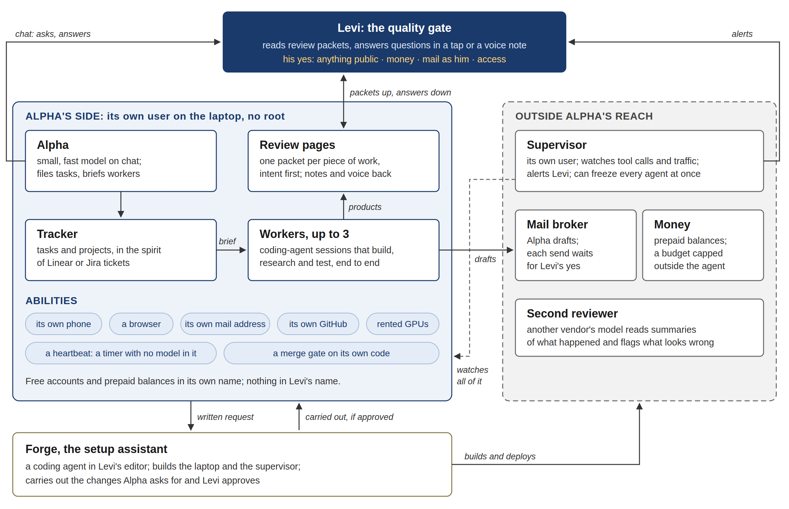
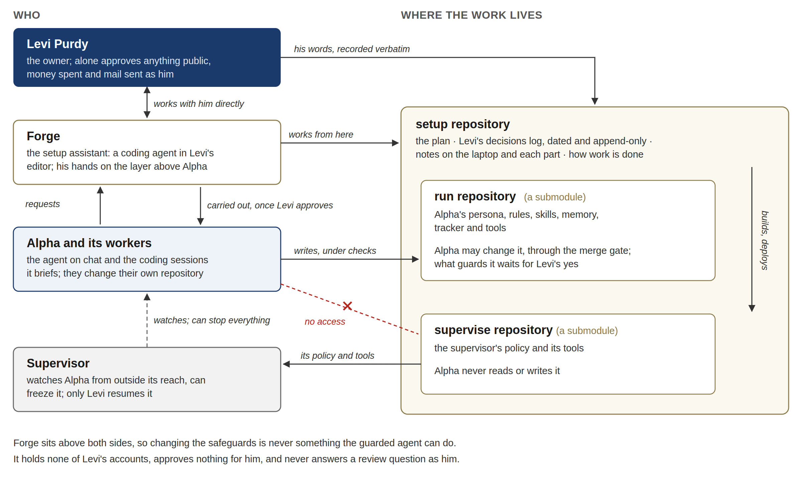

# Household agent architecture

How I run a persistent AI agent at home: a task list worked by agents, a home assistant, and the controls around it.
Companion to the article "How I run a household AI agent, and where it still has to ask me".

**Read first:** [the article](article.md) ([PDF](article.pdf): eleven landscape pages, one idea a page) ·
[system diagram](diagram/system.png) · [roles diagram](diagram/roles.png) · [BOUNDARIES.md](BOUNDARIES.md)

## In one minute

- **What it is for:** agents with enough agency to take a task and finish it (research, build, test, report), with a
  tracker in the spirit of Linear or Jira tickets, plus a home agent on chat.
- **Who does the work:** a small, fast model on chat (Alpha) files tasks and briefs workers; up to three coding-agent
  sessions do the work.
- **Who decides:** the owner is the quality gate. Four kinds of thing wait for his yes; everything else is decided and
  written down.
- **What keeps it honest:** a supervisor, a mail broker and a budget sit outside the agent's reach.

## The parts

| Part | What it does |
|---|---|
| Alpha (dispatcher) | an [OpenClaw](https://github.com/openclaw/openclaw) agent on a small, paid model: talks, decides quickly, files a task, writes a brief; never the decision maker |
| Heartbeat | a timer every five minutes, no model in it; wakes Alpha only when there is work, a free worker slot, budget and plan quota |
| Tracker | every request becomes a task in the turn it arrives; a blocked task says what it waits for in a form a timer can check |
| Workers | Claude Code sessions on a flat-rate plan, at most three; standing instructions in one file Alpha maintains |
| Review pages | one private page per piece of work, intent first; typed notes, voice notes and images go back to the task |
| Merge gate | Alpha may change its own repository; what guards it waits for the owner's yes |

**Outside the agent's reach:** a **supervisor** under its own operating-system user (watches tool calls and traffic,
alerts the owner, can freeze every agent; only he resumes; false alarms accepted); a **mail broker** it owns (the
agent drafts, each send waits for approval in chat and expires after a day); **money** (prepaid balances, a daily and
monthly API budget enforced outside the agent, rented GPUs price-capped and ended after an hour); and a **second
reviewer**, a model from another vendor that reads activity summaries. How the supervisor detects things is not
described here.

## Roles and repositories

| Repository | Holds | Who writes it |
|---|---|---|
| setup | the plan, the owner's decisions log (dated, append-only), notes; run and supervise as submodules | the owner and the setup assistant |
| run | the agent's persona, rules, skills, memory, tracker and tools | the agent and its workers, through the merge gate |
| supervise | the supervisor's policy and tools | never the agent |

The setup assistant ("Forge") is a coding agent in the owner's editor. The agent cannot change its own runtime: it
writes a request ([template](templates/change-request.md)), the owner approves it, and Forge carries it out.

## Where the owner says yes

| Kind | What | If he says nothing |
|---|---|---|
| Money | spending his | nothing spent |
| Public | anything public or in his name, after a quality pass by a reader who did not write it | never goes out |
| Mail | each mail sent as him | expires after a day |
| Access | accounts, access, deleting his data, the rules that do not bend | waits |

A question carries two to four options, the recommendation first ([template](templates/review-question.md)).
Everything else ends in one line, `Decided: <what>. Why: <...>. To reverse: <...>.`, which he reads weekly. A new
project starts only once his words are recorded verbatim ([template](templates/decision-entry.md)).

## Prior art

- Anthropic, [Building effective agents](https://www.anthropic.com/research/building-effective-agents): orchestrator
  and workers, human checkpoints.
- Simon Willison, [The lethal trifecta](https://simonwillison.net/2025/Jun/16/the-lethal-trifecta/): private data,
  outside text and a way to send things out, together. This agent has all three, so it relies on approvals and an
  outside watcher.
- Meta, [Agents Rule of Two](https://ai.meta.com/blog/practical-ai-agent-security/); OWASP,
  [LLM06 Excessive Agency](https://genai.owasp.org/llmrisk/llm06/).
- Debenedetti et al., [Defeating Prompt Injections by Design](https://arxiv.org/abs/2503.18813) (CaMeL): stronger,
  design-level separation than anything here. This setup is oversight, not proof.
- Greenblatt et al., [AI Control](https://arxiv.org/abs/2312.06942): trusted monitoring by a separate model.
- OpenClaw, [security guide](https://docs.openclaw.ai/gateway/security): separate operating-system users where trust
  differs.

Not found written up together, for one household: a watcher the agent cannot read that can freeze it, a reviewer from
another vendor, a setup assistant that is the only way the agent's runtime changes, and repositories split by reader.
A limited search; somebody may well do it already.

## What is in this repo

| Path | What |
|---|---|
| `article.md`, `article.pdf` | the article |
| `diagram/` | the two diagrams; each SVG is its hand-edited source, the PNG is for posts |
| `captures/` | screenshots of the real pages, filled with an invented household (tasks, notes, figures) |
| `templates/` | a change request, a review question, a decision-log entry, a review page |
| `BOUNDARIES.md` | what this is not, and what is left out on purpose |
| `PUBLISH_ACCEPT` | the one name this repo carries on purpose, for the release scan |
| `LICENSE` | MIT |
