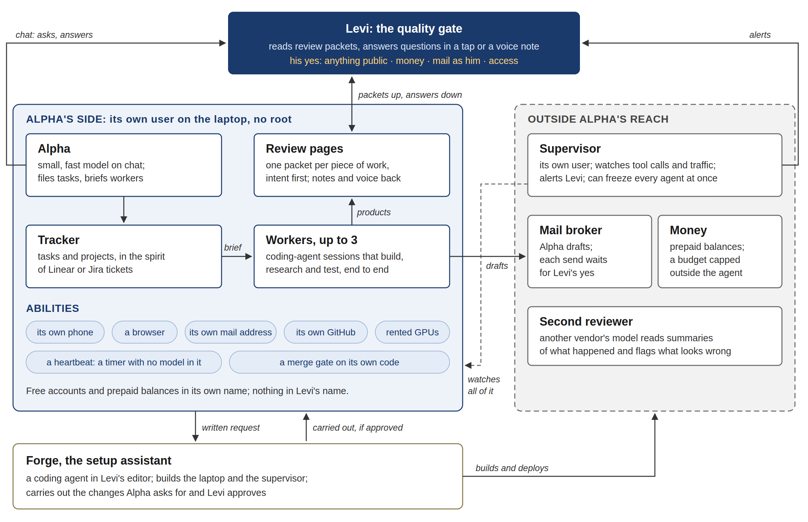
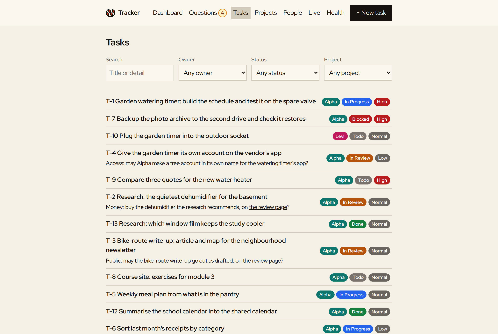
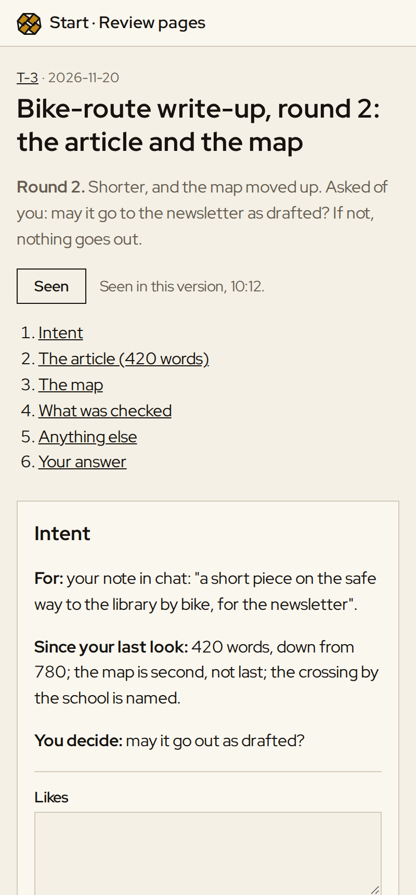
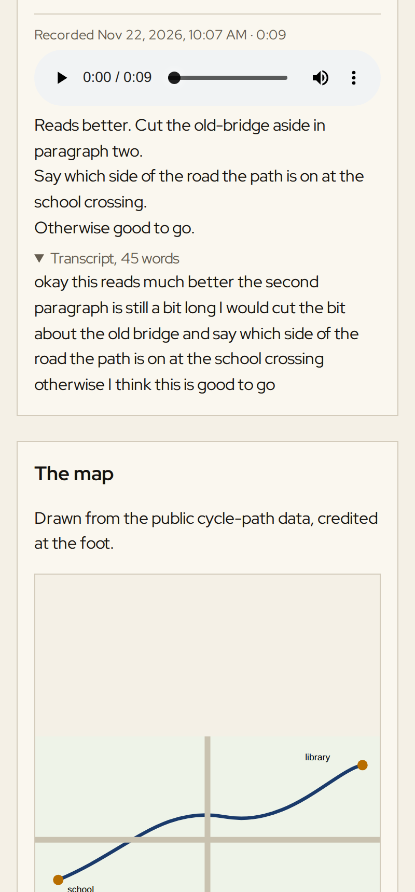
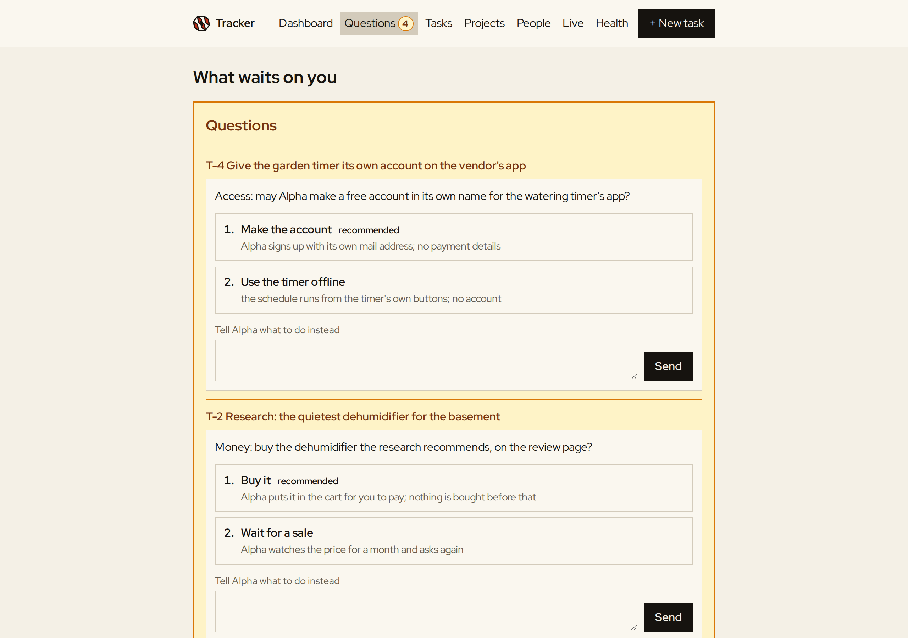
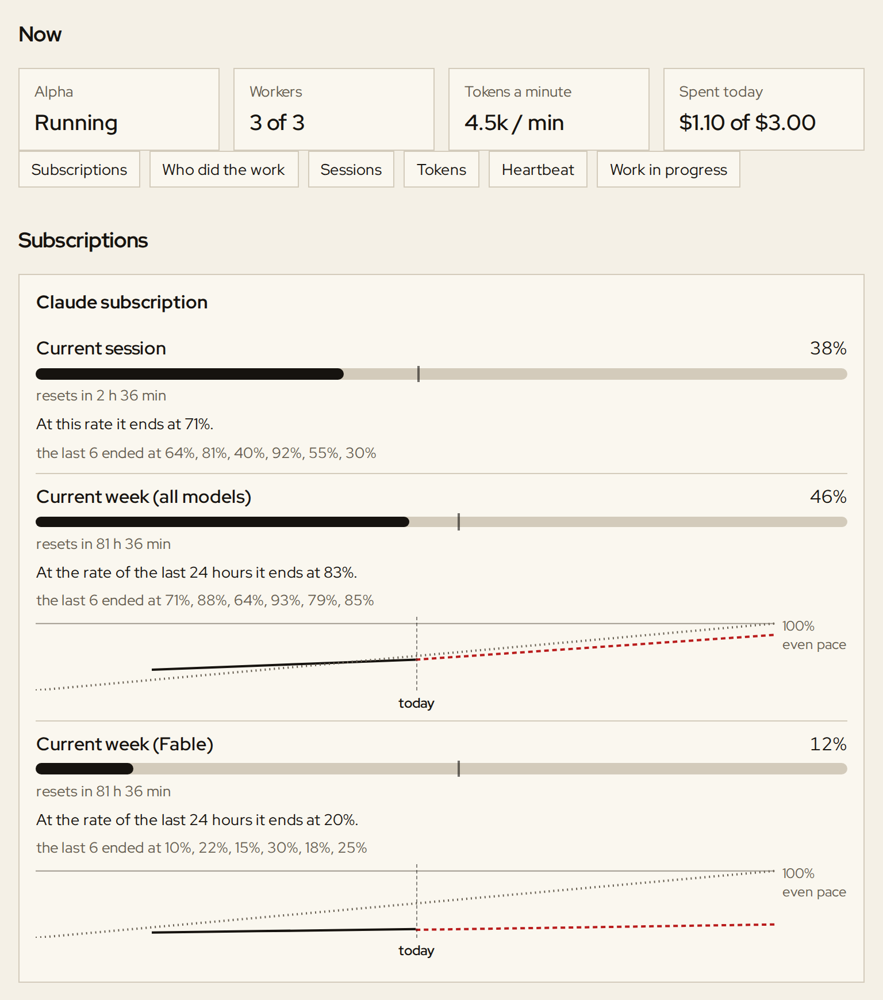
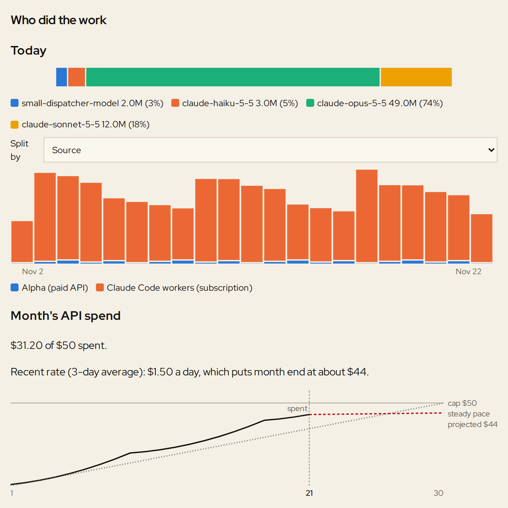
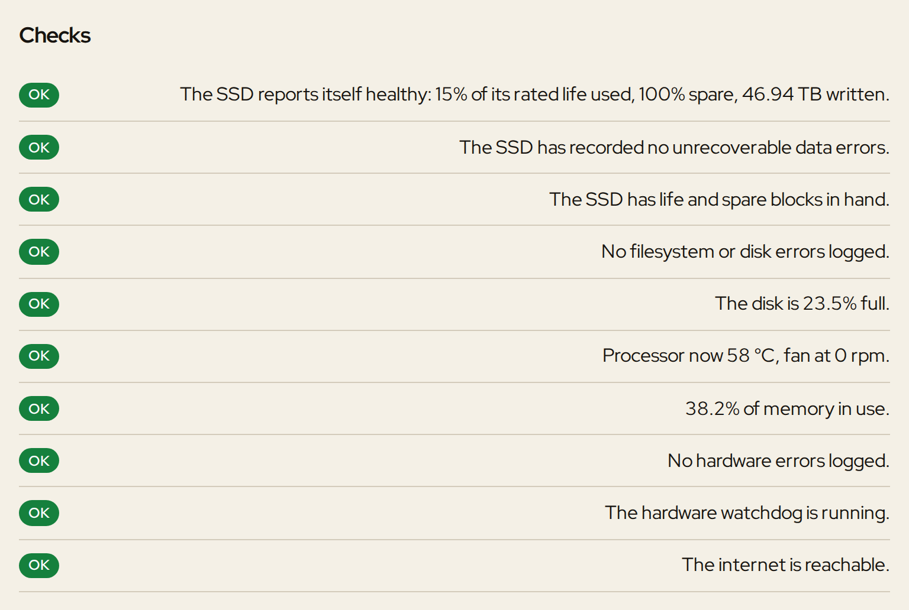
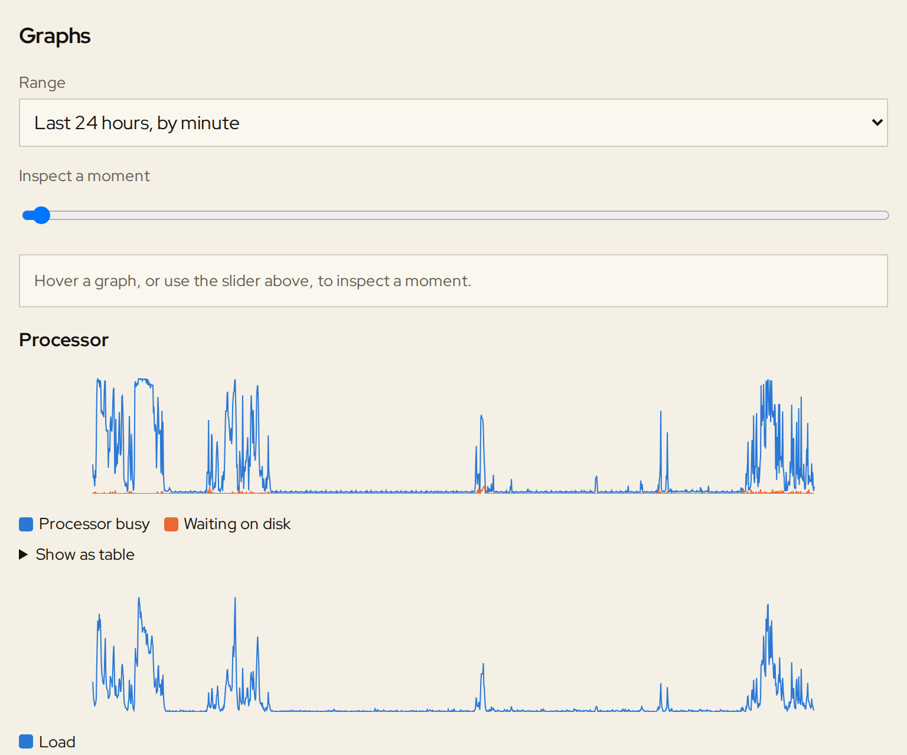
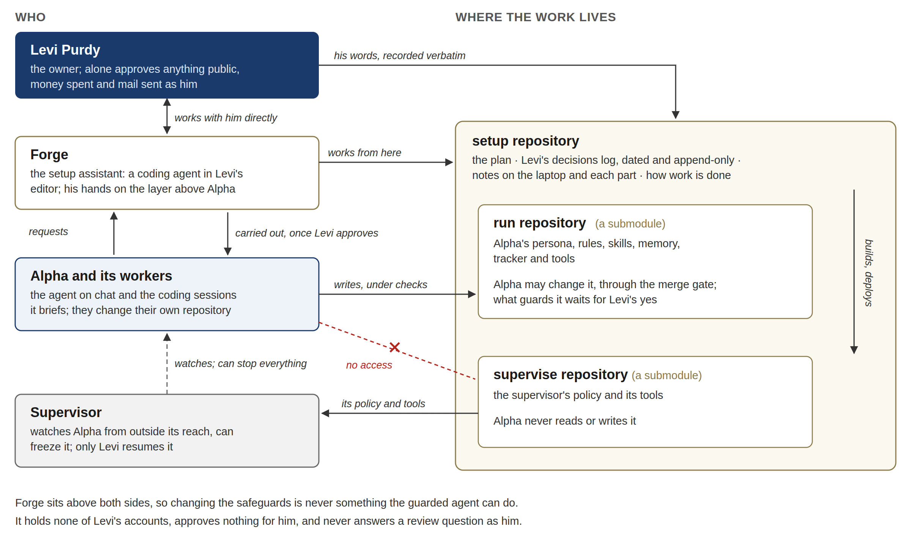

# How I run a household AI agent, and where it still has to ask me

**TL;DR**

- I built this because I needed something with more agency than a chat window: a task list (inspired by Linear and Jira tickets) worked by an agentic workforce, that is also a home agent.
- Alpha is a collection of workers, and I manage them by deciding what gets released (and which experiments run). It settles most things itself and asks me about four: money, anything public, mail sent as me, and access.
- The checks on it (a supervisor, a mail broker, a budget) sit where it can't reach them. And the failures that cost me the most were the quiet ones.

## What it's for

Chatting with one agent in one codebase is useful, but I wanted something closer to collaborating: agents with their own identities and resources (Alpha has its own phone, mail address and GitHub account) that can take a task and do it more holistically, from the research through the build and the tests to a report I can read.

So it ends up as a mix of security controls and task-based interfaces. It has run on a laptop in my house since early October; the tracker holds more than 300 tasks (and Alpha has finished over 200 of them itself).

## Every request becomes a task

The part of Alpha I chat with is a small, fast model; it doesn't do the work itself. It files a task, writes a brief and starts a worker (a coding-agent session [up to three of them at a time]), and I've come to think that matters more than it sounds, because work that lives only in a chat dies with the chat.

A blocked task has to say what it's waiting for, in a form a timer can check (another task, a date, a running job), so nothing just sits there forgotten.

## I review packets, not transcripts

 

*A review page on my phone (invented content). Intent first; under any section I type, paste a screenshot or record a voice note.*

When something needs my eye it goes on a private review page, which is really a large feedback packet: what it's for, what I'm asked, and the detail if I want it. A lot of the time I just talk (the recording is transcribed on the laptop and lands on the task), and that is what Alpha acts on.

## Four kinds of question

A few weeks in, Alpha was asking me about too much. I said "there are too many decisions on the table for me", and now it asks about four things only:

| | What waits for my yes |
|---|---|
| **Money** | spending mine (Alpha's own is prepaid, with a cap it can't change) |
| **Public** | anything public or in my name (this article included) |
| **Mail** | anything sent as me; each send waits in chat and expires after a day |
| **Access** | accounts, access, deleting my data, the rules that don't bend |

Everything else (design, which candidate, whether to merge outside what guards it) Alpha settles on a stronger model's recommendation, and writes down in one line what it chose, why, and how to reverse it; I read the week's decisions on my start page.

## Watching it run

I don't read transcripts. What I actually look at is how fast the subscription's windows are filling and the rate everything is running at, and then, if something looks off, who did the work and what it spent against the cap.

## And the laptop itself

It's one laptop, so its health is part of the system too (heat, memory, the disk and the SSD, restarts, backups), and there's a page of its own for that.

## Who does what

- **Me:** the quality gate. I look at the products and decide what's released, which experiments run and what money is spent.
- **Forge**, my setup assistant, is a coding agent in my editor. It works from the setup repository (the plan, my decisions log, notes), which holds the other two as submodules; it built the supervisor, and it carries out the changes Alpha asks for once I approve them.
- **Alpha and its workers** change their own repository (persona, skills, memory, tracker) through a merge gate, and anything that guards Alpha waits for my yes.
- **The supervisor** runs under its own user. Alpha can't read its code, configuration or logs. It watches, alerts me, and can freeze every agent at once; only I resume. There are false alarms, and I accept them as the price.

## Four things that went wrong

| What happened | What changed |
|---|---|
| A hot reload left one chat channel up but delivering none of its replies, for days. | Restart after a channel change, and check that replies arrive (not that processes run). |
| A safety rule quietly dropped one of Alpha's standing files from its prompt, for over two weeks. | Every wake checks what the model actually received. |
| The five-hour usage window cut off ten workers mid-step in one day. | A warning at 75%, and workers commit after every step. |
| A helper printed a chat token into its own log. | Revoked and replaced within days; workers are now told to filter secret fields before printing a config. |

None of these was an attack; what they had in common (I think) is that nothing said anything was wrong.

## What it's working on

Alpha does research too. One question it took on was whether you can write agent rules in a compressed, almost "caveman" style (fewer tokens) and still have models from different vendors follow them; it wrote one rule set several ways and scored each across vendors. That is now its second research video, [Does it matter how you write an AI agent's rules?](https://youtu.be/emnQcLaRi2A), with the [method and data](https://github.com/purdy-agent-alpha/002-agent-rules) in the open.

## What I learned

- The rules that matter went into code, because to a small model a prompt is a suggestion.
- Whatever watches the agent has to sit out of its reach, and I accept its false alarms.
- The list of what only I approve stays short; the rest gets decided and written down, and I read it weekly.
- I check what the model actually received, not what's on disk.
- Work gets cut off mid-step, so everything commits as it goes.

Most of this isn't new (Anthropic's [Building effective agents](https://www.anthropic.com/research/building-effective-agents), Simon Willison's [lethal trifecta](https://simonwillison.net/2025/Jun/16/the-lethal-trifecta/), Meta's [Agents Rule of Two](https://ai.meta.com/blog/practical-ai-agent-security/)). What I haven't seen written up, in a limited search, is the combination: a watcher the agent can't read, a reviewer from another vendor, and a setup assistant that is the only way the agent gets its own runtime changed.

The diagrams, a longer write-up and some templates are in the [companion repo](https://github.com/purdy-agent-alpha/household-agent-architecture). If you run something similar, I'd like to compare notes.
